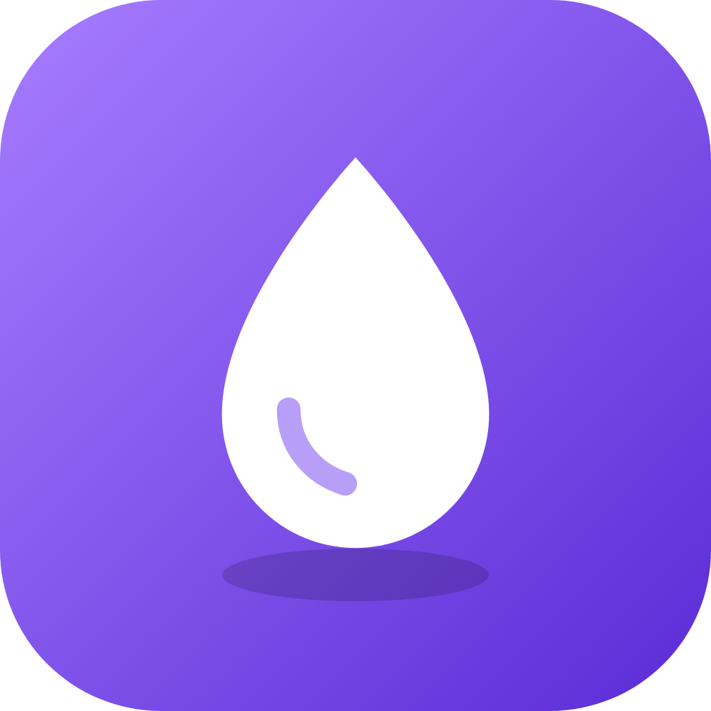

<p align="center">
  <!-- Hero banner placeholder: replace this URL with your own 1600x500 banner (e.g. github/readme/hero-banner.png). -->
  
</p>

<p align="center">
  
</p>

<h1 align="center">Soulleak</h1>

<p align="center">
  <b>A high-end, gamified desktop music client built for gaming and terminally-online internet culture.</b><br>
  Pitch-black Obsidian UI, record-scratch exits, a mini-player that lives on top of your game, and a rank ladder that knows exactly how much you've been listening.
</p>

<p align="center">
  
</p>

<p align="center">
  <a href="https://github.com/AliHayani/soulleak/releases">
    
  </a>
  &nbsp;
  <a href="#listening-ranks--badges">
    
  </a>
  &nbsp;
  <a href="#discord-rich-presence">
    
  </a>
</p>

<p align="center">
  <a href="#features">Features</a> &nbsp;·&nbsp;
  <a href="#audio-suite">Audio Suite</a> &nbsp;·&nbsp;
  <a href="#obsidian-premium-ui">Interface</a> &nbsp;·&nbsp;
  <a href="#listening-ranks--badges">Ranks</a> &nbsp;·&nbsp;
  <a href="#download-and-install">Install</a> &nbsp;·&nbsp;
  <a href="#faq">FAQ</a> &nbsp;·&nbsp;
  <a href="#build-from-source">Build</a>
</p>

<p align="center">
  <a href="https://github.com/AliHayani/soulleak/stargazers"></a>
  <a href="https://github.com/AliHayani/soulleak/commits/soulleak"></a>
  <a href="https://github.com/AliHayani/soulleak/releases"></a>
  <a href="LICENSE"></a>
</p>

> [!NOTE]
> **Soulleak is a customized fork of [Riff](https://github.com/rootscripts/riff)** by rootscripts, the open-source desktop music player for YouTube Music, SoundCloud, and local files. Soulleak keeps Riff's playback engine and adds its own interface, audio presets, mini-player, gamification and Discord integration on top. Riff's original MIT license is preserved in [LICENSE](LICENSE).

## What is Soulleak?

Soulleak is a desktop music client for people who listen while they play. It streams from **YouTube Music**, **YouTube**, and **SoundCloud**, plays your **local files**, and wraps it all in a pitch-black, violet-lit interface built to sit next to a game on a second monitor, or on top of it.

It's built with **Electron** and **vanilla JavaScript** (no framework), runs without ads or an account, and keeps your settings, history, and listening stats on your own machine.

## Features

- **Obsidian Premium UI**: an edge-to-edge, pitch-black three-column layout with violet and indigo accents, hairline borders, and controls that only appear when you hover.
- **osu!-style graceful exit**: close the app and the screen fades to black, the logo glows in, and the song winds down like a record stopping (speed and pitch sink together while the volume fades) before Soulleak quits.
- **Discord Rich Presence**: your status shows the song, the artist, any active effects (like "Slowed + reverb"), and the Soulleak logo.
- **Interactive seek bar**: a violet scrubber with buffered progress, a glowing knob, a hover time preview, and arrow-key seeking.
- **Floating glass queue**: a Spotify-style "Up Next" flyout on the playbar. Queue or unqueue songs from any row or right-click menu; queued songs play next, even in shuffle.
- **7-tier listening ranks**: climb from **Spawn** to **True Larper** on real listening time, and unlock badges like **Hyperfixated** and **Terminally Online**.
- **Gaming mini-player**: a borderless, always-on-top overlay with cover art, transport, repeat, a seek bar and volume. Toggle it with **Ctrl+Alt+I**; drag it and it snaps to the nearest corner.
- **Immersive fullscreen**: big cover art, a live beat wave, and synced lyrics with your choice of font and color, plus a matching ambient glow.
- **Soul Search**: type a mood ("late night drive", "studying", "ranked grind") and get the most-played community playlists for it from YouTube, SoundCloud, and Spotify.
- **Stall detector**: if a song hangs for 10 seconds, Soulleak offers to skip it, retry it, or reload the player.
- **Everything from Riff**: local library playback, synced lyrics, playlist import from Spotify / Apple Music / Deezer, downloads, themes, plugins, and a custom CSS editor.

## Audio Suite

### One-click presets
- **Slowed + Reverb**: drops speed and pitch together and opens up the room.
- **Nightcore**: faster and higher, the way it's supposed to be.
- **8D Audio**: the song orbits around your head (HRTF panning driven by a slow LFO). Best on headphones.
- Apply any preset to a single song straight from the row's hover menu; active effects show as tags under the song title.

### Playback
- **3-second gapless crossfade** between tracks by default (adjustable in settings).
- **Repeat this song** with a glowing violet toggle, on the playbar and in the mini-player.
- 10-band and 3-band equalizer, pitch, speed, reverb, echo, and distortion, all real time through the Web Audio API.

## Obsidian Premium UI

- **Sidebar**: Home, Soul Search, a "How do you feel tonight?" mood box, your library, and your current rank.
- **Song rows**: favorite, queue, effects, and download controls appear on hover; the playing or selected song gets a glowing violet outline.
- **Playbar**: a full-width frosted-glass console with cover art, effect tags, the seek bar, and buttons for fullscreen, Up Next, and the mini-player.
- **Up Next**: a floating glass panel threading "Now playing", "Queued by you", and "Next from…" on a glowing rail. Click to jump, hover to remove, or clear your queue in one go.
- **Fullscreen lyrics**: a discreet style pill swaps between five typefaces and lets you pick any lyric color; the background glows in the same color and pulses with the beat.

## Listening Ranks & Badges

Every second of real playback counts (paused or muted time doesn't). Stats are stored locally in IndexedDB, and **Settings → Badges** shows your exact listening time, what each rank and badge needs, and how long until the next unlock.

| Rank | Title | Listening time |
|:---:|---|---|
| 1 | **Spawn** | 0 h |
| 2 | **Wanderer** | 0.5 h |
| 3 | **Aux Owner** | 1.5 h |
| 4 | **Gatekeeper** | 3.5 h |
| 5 | **Scrobbler** | 7 h |
| 6 | **Soul Leaker** | 24 h |
| 7 | **True Larper** | 50 h |

Each rank has its own emblem that grows more ornate as you climb: wings at Scrobbler, a crown at Soul Leaker, and sparkles at True Larper.

| Badge | How to unlock |
|---|---|
| **Parasocial** | 10 hours on a single artist |
| **Hyperfixated** | 2 hours looping a single song |
| **Terminally Online** | 100 hours of total listening |

## Discord Rich Presence

While a song plays, your Discord status shows **Listening to Soulleak** with the track, the artist, elapsed time, the cover art, and the Soulleak logo. Active audio effects ride along, e.g. `Shakira · Slowed + reverb`, and update the moment you change them.

## Download and install

Download the latest Windows installer from the [Releases page](https://github.com/AliHayani/soulleak/releases) and run `soulleak-<version>-win-x64.exe`. The installer lets you choose where to install, and uninstalling doesn't delete your data.

> [!TIP]
> The installer isn't code-signed yet, so Windows SmartScreen may show "Windows protected your PC" on first launch. Click **More info → Run anyway**.

## Build from source

Requires Node.js 18 or newer and npm.

```bash
git clone https://github.com/AliHayani/soulleak.git
cd soulleak
git checkout soulleak
npm install
npm start        # run the dev version
npm run dist     # build the installer into dist/
```

## FAQ

**Is Soulleak free?**
Yes. Like Riff, it's free software under the MIT license, with no subscriptions or paywalls.

**Does it show ads or need an account?**
No ads and no account. Optional Spotify and Google sign-ins only unlock imports and Spotify results in Soul Search.

**What's the mini-player shortcut?**
**Ctrl+Alt+I** shows or hides it from anywhere, even mid-game. It shows without stealing focus, so your game keeps your keyboard.

**Does closing really slow the song down?**
Yes. Closing (X, Alt+F4, or Quit from the tray) takes two seconds: the screen goes black, the logo comes in, and the music winds down like a stopping record.

**Where are my ranks and stats stored?**
Locally, in the app's IndexedDB on your machine. Nothing is uploaded.

**Which operating systems are supported?**
Soulleak is built and tested on Windows 10/11. The Linux and macOS build targets are inherited from Riff but haven't been tested for Soulleak.

## Credits

Soulleak is built on [Riff](https://github.com/rootscripts/riff) by rootscripts. Soulleak's interface, presets, mini-player, ranks, badges, and integrations are by **Ali Hayani Mounir**.

## Disclaimer

Soulleak is developed for educational purposes and personal media management. Users are responsible for following the terms of service of third-party platforms and applicable copyright law.

## License

[MIT](LICENSE). The original Riff copyright notice is preserved.

---

<sub>Keywords: gaming music player, desktop music client, always-on-top mini player, osu! exit animation, slowed and reverb, nightcore, 8D audio, YouTube Music desktop app, SoundCloud desktop player, Discord Rich Presence, listening stats, music gamification, Electron music player, vanilla JS.</sub>
